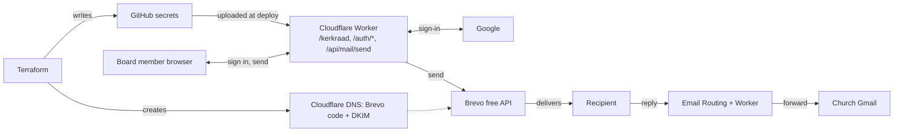

# Church Board Mail via Google Sign-in: Implementation Spec

Oct 24, 2026 · @Rainier van Niekerk

## Summary

Church board members sign in with Google on a private `/kerkraad` page and send mail as the church's role addresses (`welkom@`, `klerk@`, `tesourier@` and `kerk@` at launch, more later) through Brevo's free API. This replaces Gmail "Send mail as", which Google ends for third-party addresses in January 2027.

- **Worker** handles Google sign-in (OIDC code flow with PKCE), a signed session cookie, an email allow-list, and the send endpoint. No Cloudflare Access.
- **Terraform** (`/terraform`) manages the Brevo DNS records on `sdatygerberg.co.za` plus the deploy secrets in GitHub Actions and a new Google Cloud project. It cannot create the consent screen or OAuth client inside that project; that step is manual (see Manual steps).
- **Cost:** R0. Brevo free is 300 emails/day; Cloudflare Workers and DNS stay on the free plan.
- **Out of scope for v1:** reading mail, threading, attachments.

## Decisions and assumptions

The state backend and the Google project were both decided in comments on this doc. The rest follow from your request or from constraints found while researching.

| Topic | Decision | Reason |
| --- | --- | --- |
| Sign-in | Google OIDC authorization-code flow with PKCE, implemented in the Worker | Your request. Avoids a Cloudflare Access app and a `jose` dependency. |
| Google OAuth client | Created by hand in Google Auth Platform; Terraform outputs the exact redirect URI and origin to paste | `google_iam_oauth_client` is for Workforce Identity Federation, not Sign in with Google. No other Terraform resource creates a Web client. |
| Google project | A new project, "SDA Tygerberg", created by Terraform (**decided in a comment**) | Keeps this site's consent screen and client apart from the webinar app. Terraform makes the project; the consent screen and client are still created by hand inside it. |
| Scopes | `openid email` only | Non-sensitive scopes; no Google verification review expected. |
| Session | Signed cookie (HMAC-SHA256), 8 hours, no KV or D1 | Nothing to provision; the allow-list is re-checked on every request. |
| Sending | Brevo REST API from the Worker | Free, works from a Worker with `fetch`. |
| Secrets | Terraform writes them to GitHub Actions secrets; the existing `wrangler-action` `secrets:` block uploads them to the Worker | Matches how `YOUTUBE_API_KEY` already reaches production. |
| State backend | Azure Storage through the `azurerm` backend, Entra ID auth (**confirmed in a comment**) | State holds secrets, so it must be private and encrypted. Azure encrypts at rest and locks state with a blob lease. Not free like R2, but a state file is a few kilobytes. Use a subscription you own, not an employer's. |
| DNS | Terraform adds new Brevo records only; it never edits the apex SPF or the existing DMARC record | Those protect live church mail. Terraform prints the merged values to apply by hand. |

## Architecture

Solid arrows are runtime calls; the dashed arrow is the DNS that lets Brevo's mail pass DKIM. Terraform (top) provisions what the Worker needs; the Worker (middle) holds the only copy of the Brevo key; a recipient's reply returns through the existing inbound route into the church Gmail.

## Auth design

The Worker runs the OpenID Connect authorization-code flow with PKCE and issues its own signed session cookie. It never stores Google tokens.

| Route | Method | Purpose |
| --- | --- | --- |
| `/kerkraad` | GET | Static compose page. Noindex, outside the sitemap. Shows a sign-in button until a session exists. |
| `/auth/login` | GET | Starts the flow. |
| `/auth/callback` | GET | Finishes the flow and sets the session. |
| `/auth/logout` | POST | Clears the session cookie. |
| `/api/mail/session` | GET | Returns the signed-in email, or 401. |
| `/api/mail/send` | POST | Sends one message. |

1. **Login.** `/auth/login` generates `state`, `nonce` and a PKCE verifier, stores them in a signed `__Host-kerkraad_flow` cookie (HttpOnly, Secure, SameSite=Lax, 10 minutes), and redirects to `accounts.google.com/o/oauth2/v2/auth` with scope `openid email`, `code_challenge_method=S256` and `prompt=select_account`.
2. **Callback.** Check `state` against the cookie. Exchange the code at `oauth2.googleapis.com/token` with the client secret and the PKCE verifier.
3. **ID token.** Check `iss`, `aud` (our client id), `exp`, `nonce` and `email_verified`. The signature check is skipped because the token arrives directly from Google's token endpoint over TLS, which OpenID Connect Core allows; this also avoids a `jose` dependency.
4. **Allow-list.** Lowercase the `email` claim and require an exact match in `BOARD_ALLOWED_EMAILS`. Otherwise answer 403 and set no cookie.
5. **Session.** Set `__Host-kerkraad` = base64url(`{email, iat, exp}`) + `.` + HMAC-SHA256 under `SESSION_SECRET`. HttpOnly, Secure, SameSite=Lax, 8 hours. Redirect to `/kerkraad`.
6. **Every API call.** Verify the HMAC in constant time, check `exp`, and re-check the email against the current allow-list, so removing a board member takes effect on the next deploy.

CSRF on `/api/mail/send`: SameSite=Lax, a required `Content-Type: application/json` (forces a preflight), and an `Origin` header equal to the site origin.

## Worker changes

A separate PR from the Terraform one, branched from `origin/dev` per `CLAUDE.md`. The version bump goes in its own `Release vX.Y.Z` PR.

| File | Change |
| --- | --- |
| `src/worker/auth.ts` | New. Login, callback, logout, session sign and verify. |
| `src/worker/mailSend.ts` | New. Validates and sends through Brevo. Returns an outcome like `handleContact`. |
| `src/worker/index.ts` | Six routes. `run_worker_first` is already `/*`, so `wrangler.jsonc` needs no path change. |
| `src/pages/kerkraad.astro`, `src/components/react/BoardMail.tsx`, `src/data/boardCopy.ts` | New page and form, Afrikaans copy. |
| `wrangler.jsonc` | New public var `MAIL_SEND_FROM` (JSON array of allowed From addresses: welkom@, klerk@, tesourier@, kerk@ at launch). Production only; devtest stays without mail config (C-61). |
| `.github/workflows/deploy-production-cloudflare.yml` | Add the five secret names to `secrets:` and to the step's `env:`. Names come from `terraform output worker_secrets_block`. |
| `src/pages/robots.txt.ts`, `src/pages/sitemap.xml.ts` | Disallow and omit `/kerkraad`, `/auth/`, `/api/mail/`. |
| `docs/email-routing.md`, `test/emailRoutingDoc.test.mjs`, `CONCERNS.md` | Document the new outbound path; next free `C-` number. |
| `test/auth.test.mjs`, `test/mailSend.test.mjs` | New (section 9). |

**Worker environment**

| Name | Kind | Set by |
| --- | --- | --- |
| `GOOGLE_CLIENT_ID`, `GOOGLE_CLIENT_SECRET` | secret | Terraform to GitHub to deploy |
| `SESSION_SECRET`, `BREVO_API_KEY`, `BOARD_ALLOWED_EMAILS` (comma-separated) | secret | Terraform to GitHub to deploy |
| `MAIL_SEND_FROM` | var | `wrangler.jsonc` |

**Send endpoint.** Body `{from, to[], subject, body}`.

- `from` must be in `MAIL_SEND_FROM`.
- 1 to 5 recipients, each matching the same loose regex as `contact.ts`.
- Subject 150 characters at most, body 10 000 at most.
- Control characters stripped from header fields, the `headerSafe` approach from `contactEmail.ts`.
- A footer line `Gestuur deur <session email>` is appended so shared role addresses stay attributable.

**Brevo call.** `POST https://api.brevo.com/v3/smtp/email` with an `api-key` header and JSON `sender`, `to`, `replyTo` (the role address itself, so replies come back through Email Routing), `bcc` (`archive@sdatygerberg.co.za`), `subject` and `textContent`. Re-check the field names against Brevo's API reference when implementing.

**Outcomes:** `sent`, `invalid`, `unauthorised`, `not-configured`, `send-error`. Timeout 10 seconds, like `forward()` in `contact.ts`.

## Terraform

The code is written to `/terraform` in the working tree on your machine, untracked, nothing committed. Terraform 1.17.0 passes `fmt`, `validate` and ten offline `terraform test` runs against mocked providers. It has not been planned against your real Cloudflare or GitHub accounts.

| File | Contents |
| --- | --- |
| `versions.tf`, `.terraform.lock.hcl` | Terraform 1.10 or newer; providers cloudflare 5.28.1, github 6.13.0, google 7.46.2, random 3.9.1, with hashes for Windows, macOS (both) and Linux. |
| `providers.tf` | Credentials from the environment only: `CLOUDFLARE_API_TOKEN`, `GITHUB_TOKEN`, and your `az login` identity for state. |
| `variables.tf` | Inputs with validation: DKIM record types, Google project id, optional Google client (both values or neither), non-empty lowercase allow-list. |
| `main.tf` | Zone lookup, Brevo DNS records, `random_password.session`, up to five `github_actions_secret` resources. |
| google.tf | The new project: no default network, destroy-protected, no APIs enabled. |
| `checks.tf` | Warns if the production redirect is not https or a DKIM CNAME does not point at a Brevo host. |
| `outputs.tf` | `google_oauth_client_setup` (origins and redirect URIs to paste), `worker_secrets_block` (names for the workflow), `dns_records`. |
| `backend.tf`, `backend.hcl.example` | Remote state in Azure Storage through the `azurerm` backend, Entra ID auth, blob-lease locking. |
| `tests/plan.tftest.hcl` | Resource counts, secret names, exact OAuth URIs, and project protection, the first apply without a client, and six rejected-input cases. |
| `README.md`, `terraform.tfvars.example`, `.gitignore` | Runbook, input template, state and tfvars excluded. |

**Managed:** the Brevo code TXT, the DKIM records (CNAME or TXT, as Brevo issues them), the Google Cloud project, and the five Worker secrets (three until the Google client exists).

**Deliberately not managed:**

- The Google consent screen and OAuth client. `google_iam_oauth_client` serves Workforce Identity Federation, not Sign in with Google, and google\_iap\_brand only creates an Internal consent screen. Terraform only prints what to paste.
- The apex SPF and `_dmarc` records, which protect live church mail.
- The Worker, routes and non-secret vars, which stay in `wrangler.jsonc`.

Secrets reach production in three hops: Terraform writes the GitHub Actions secret, the deploy step's `env:` exposes it, and the `secrets:` list makes `wrangler-action` run `wrangler secret put`. This is how `YOUTUBE_API_KEY` already works, and a name missing from either list silently never reaches the Worker.

## Manual steps

Do these in order. Steps 1, 2 and 4 happen outside Terraform.

1. **State storage and tokens.** Create a storage account with a private `tfstate` container (public access off, shared-key access off, versioning and soft delete on) and grant yourself Storage Blob Data Contributor on the container. Create a Cloudflare API token with Zone:Read and DNS:Edit on `sdatygerberg.co.za` only, and a fine-grained GitHub token with Secrets read/write on this repository only.
2. **Brevo.** Create the account, add `sdatygerberg.co.za` under Domains, and copy the Brevo code and the DKIM records into `terraform.tfvars`. Add each role address as a sender: `welkom@`, `klerk@`, `tesourier@` and `kerk@` at launch. Brevo's verification mail follows the existing routing, so `tesourier@` reaches the treasurer and the others reach the church Gmail. Create a v3 API key.
3. **`terraform apply`, first pass.** Creates the Google project, the Brevo DNS records and three secrets. Leave both Google client values unset.
4. **Google Auth Platform.** In the project Terraform created, open Google Auth Platform, then Clients, then Create client.
   - Type: Web application. Name: for example "Tygerberg kerkraad mail".
   - Authorized JavaScript origins: `https://sdatygerberg.co.za` and `http://localhost:8787` (for `wrangler dev`).
   - Authorized redirect URIs: `https://sdatygerberg.co.za/auth/callback` and `http://localhost:8787/auth/callback`.
   - These are fixed by the domain. `terraform output google_oauth_client_setup` repeats them as a check.
   - Consent screen: External, scopes `openid` and `email`, app name and support email set. Publish it ("In production") so board members outside a test-user list can sign in.
   - Add the client id and secret to the Terraform inputs, apply again, confirm the next plan is empty, then open the Worker PR.

The cutover has to finish before January 2027, about ten weeks from today.

## Security and POPIA

The main risk is an endpoint that mails anyone for anyone. Four independent checks stand in front of it, and Brevo's free 300 emails a day caps the damage if all four fail.

| Risk | Control |
| --- | --- |
| Open relay | Valid session, allow-listed email, fixed `From` list, `Origin` check. |
| Unwanted Google accounts | `email_verified` required and exact match in the allow-list; there is no domain wildcard. |
| Session theft or forgery | `__Host-` cookie, HttpOnly, Secure, 8-hour expiry, HMAC under a 48-character random secret. |
| Secrets in Terraform state | Private Azure container (public and shared-key access off, versioning on); scoped Cloudflare and GitHub tokens; `terraform.tfvars` and `backend.hcl` gitignored. State still holds the values in plain text. |
| Allow-list is personal data | Shipped as a Worker secret, not a committed var (unlike the role addresses in ADR-0001). |
| Logs | Outcome and the signed-in board member's email only. Never recipients or message text, matching C-20 and C-66. |
| Archive copy | The BCC to `archive@` stores recipients' addresses and message text in R2 under the existing 7-year retention. Confirmed in a comment as intended for outgoing mail. |
| Token scope | Cloudflare token limited to this zone's DNS; GitHub token limited to this repository's secrets. |

## Test plan and rollout

Terraform is checked offline; the Worker is checked with the repo's existing `node --test` setup.

**Tests**

- `terraform fmt -check`, `validate` and `test` (done: 10 passing runs).
- `test/auth.test.mjs`: state mismatch, nonce mismatch, wrong `aud`, `email_verified` false, address not on the list, expired or tampered cookie, and a board member removed from the list mid-session.
- `test/mailSend.test.mjs`: unlisted `From`, header injection in subject and recipient, over-length body, missing `Origin`, Brevo failure and timeout, and `not-configured` when a secret is absent.
- `test/emailRoutingDoc.test.mjs`: extended so `MAIL_SEND_FROM` and the doc agree.

**Rollout order**

1. Apply Terraform. The DNS records and secrets sit unused until the Worker ships.
2. Merge the Worker PR to `dev`. Devtest answers `not-configured` by design.
3. Promote `dev` to `main` with a merge commit, then fast-forward `dev`, per `CLAUDE.md`.
4. Smoke test on production: sign in as a listed board member, send to your own address from each role address, and confirm the received headers show `dkim=pass` with `header.d=sdatygerberg.co.za`. Reply from the recipient and confirm it reaches the church inbox.
5. Sign in with an unlisted Google account and confirm 403.

**Rollback.** Revert the Worker PR to remove every route. `terraform destroy` removes the DNS records and secrets, then stops at the protected Google project by design; leaving the Brevo records in place is harmless.

## Open items

**Correction.** An earlier message in the chat said Brevo needs an SPF include merged into the apex record. Brevo's domain guide lists only the Brevo code, DKIM and DMARC records, so this design makes no SPF change.

**Needs your decision**

- [ ] State backend: Azure Storage (decided).
- [ ] Google project: new project, created by Terraform (decided).
- [x] Keep outgoing mail in the R2 archive for 7 years (confirmed).
- [ ] Which board members go on the allow-list at launch.

**Unverified, to confirm during implementation**

- [ ] Cloudflare provider TXT quoting. The second `terraform plan` after the first apply must be empty; if not, adjust the quoting in `main.tf`.
- [ ] State lives in the `sda-tygerberg` container of the `protecteddatabackups` storage account in the Cloudkid Azure tenant. The resource group is still needed.
- [ ] Whether Brevo's free plan places limits on new accounts, and whether each sender address needs its own verification even on an authenticated domain.
- [ ] Brevo API field names and the 10-second timeout, against the live API reference.
- [ ] That `openid email` is a non-sensitive scope pair, so an External app published to production needs no Google verification review and has no user cap. Confirmed against Google's help page; the first real sign-in should still show no unverified-app warning.
- [ ] Terraform has only run against mocked providers. The first real run uses the Cloudkid Azure tenant for state, plus the live Cloudflare, GitHub and Google accounts.

* [ ] Project creation with Application Default Credentials: the Cloud Resource Manager API may need enabling on gcloud's client project, and a personal-account project is assumed to need neither an organisation nor billing.

**Optional later:** a Cloudflare rate-limit rule on `/auth/*` and `/api/mail/*`, managed in the same Terraform. Free-plan rule limits are unchecked.
