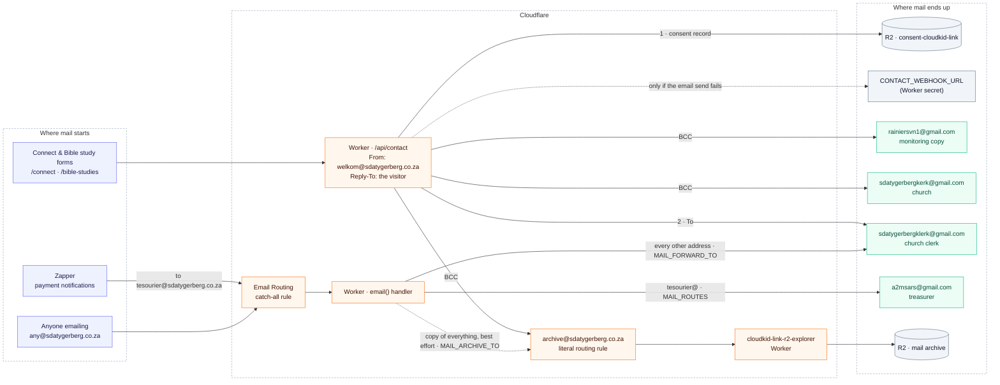

# Email routing

Every address the website sends to, sends from or receives on, and where each
message ends up. `wrangler.jsonc` is the source of truth;
`test/emailRoutingDoc.test.mjs` fails when this page and its `vars` disagree.

Solid arrows always happen. Dotted arrows are fallbacks or best-effort copies.

## Addresses

| Address | Role | Set in `wrangler.jsonc` |
|---|---|---|
| `welkom@sdatygerberg.co.za` | From on every form email. Not a mailbox: replies go to the visitor via Reply-To; mail sent *to* it goes to the clerk | `CONTACT_EMAIL_FROM`, `allowed_sender_addresses` |
| `sdatygerbergklerk@gmail.com` | Receives every form email (To) and all inbound mail with no route | `CONTACT_EMAIL_TO`, `MAIL_FORWARD_TO` |
| `sdatygerbergkerk@gmail.com` | BCC on every form email | `CONTACT_EMAIL_BCC` |
| `rainiersvn1@gmail.com` | BCC on every form email (monitoring) | `CONTACT_EMAIL_BCC` |
| `tesourier@sdatygerberg.co.za` | Zapper's merchant notification address. Not a mailbox | `MAIL_ROUTES` key |
| `a2msars@gmail.com` | Treasurer. Receives everything sent to `tesourier@` | `MAIL_ROUTES` value |
| `archive@sdatygerberg.co.za` | Archive. BCC on form emails and a copy of all inbound mail, filed in R2 | `CONTACT_EMAIL_BCC`, `MAIL_ARCHIVE_TO` |

Every form-email recipient must also be in `send_email.allowed_destination_addresses`,
or the whole send is rejected (C-31).

## Outside this repo (Cloudflare dashboard and Zapper)

None of these are checked by tests, build or deploy. Out of step, mail bounces or
disappears; the only diagnostic is `wrangler tail tygerberg-sda-website`
(C-64, C-65).

- **Verified destination addresses:** every Gmail above, plus `archive@`.
- **Email Routing rules:** the catch-all → *Send to a Worker* → `tygerberg-sda-website`;
  `archive@` → *Send to a Worker* → `cloudkid-link-r2-explorer`.
- **Email Sending:** `sdatygerberg.co.za` onboarded, so `welkom@` can send (SETUP §6.2).
- **Zapper merchant profile:** notification email `tesourier@sdatygerberg.co.za`.
- **R2 buckets:** the archive bucket is configured on `cloudkid-link-r2-explorer`;
  neither bucket has a retention rule in this repo (C-34).

The devtest Worker has no mail bindings or vars: it sends nothing and receives nothing (C-61).

## Changing an address

1. Edit `wrangler.jsonc`: the var, and the `send_email` lists for a form recipient or sender.
2. Update this page. `npm test` fails until it matches.
3. Verify any new destination in Cloudflare **before** the deploy reaches production.
