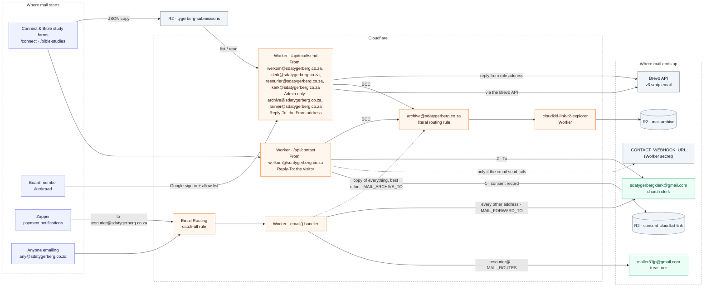

# Email routing

Every address the website sends to, sends from or receives on, and where each
message ends up. `wrangler.jsonc` is the source of truth;
`test/emailRoutingDoc.test.mjs` fails when this page and its `vars` disagree.

Solid arrows always happen. Dotted arrows are fallbacks or best-effort copies.

## Addresses

| Address | Role | Set in `wrangler.jsonc` |
|---|---|---|
| `welkom@sdatygerberg.co.za` | From on every form email. Not a mailbox: replies go to the visitor via Reply-To; mail sent *to* it goes to the clerk. Also a board send-as address | `CONTACT_EMAIL_FROM`, `allowed_sender_addresses`, `MAIL_SEND_FROM` |
| `klerk@sdatygerberg.co.za` | Board send-as address | `MAIL_SEND_FROM` |
| `kerk@sdatygerberg.co.za` | Board send-as address | `MAIL_SEND_FROM` |
| `sdatygerbergklerk@gmail.com` | Receives every form email (To) and all inbound mail with no route | `CONTACT_EMAIL_TO`, `MAIL_FORWARD_TO` |
| `tesourier@sdatygerberg.co.za` | Zapper's merchant notification address. Not a mailbox. Also a board send-as address | `MAIL_ROUTES` key, `MAIL_SEND_FROM` |
| `muller31jp@gmail.com` | Treasurer. Receives everything sent to `tesourier@`; sends and is notified as treasurer only | `MAIL_ROUTES` value, `BOARD_SEND_AS` |
| `archive@sdatygerberg.co.za` | R2 archive. Admins may also use it as a Board Mail From address and recipient; other members cannot | `CONTACT_EMAIL_BCC`, `MAIL_ARCHIVE_TO`, `BOARD_ADMIN_ONLY_EMAILS` |
| `rainier@sdatygerberg.co.za` | Admin-only Board Mail identity for From, To, and incoming messages routed through the catch-all | `BOARD_ADMIN_ONLY_EMAILS` |

Every form-email recipient must also be in `send_email.allowed_destination_addresses`,
or the whole send is rejected (C-31).

## Board mail

Board members sign in with Google on the private `/kerkraad` page and send as
one of the four role addresses through the Brevo API. Admins also get
`archive@` and `rainier@` as From addresses and recipients. The Worker rejects
non-admin sends that use either address as From or To, and hides Inbox and Sent
messages involving those addresses from non-admins. Messages sent directly to
`rainier@` arrive through the catch-all and appear only to admins in the Inbox. The archive's automatic BCC remains system-controlled
for retention. The Worker holds the Brevo key; replies to role addresses return
through Email Routing to the church inbox. The allow-list of board members is a
plain-text `BOARD_ALLOWED_EMAILS` var in `wrangler.jsonc` (not a secret, so the
dashboard shows the value) — readable to repo and Cloudflare collaborators,
never on the public site (C-68).

Per-sender send-as: `BOARD_SEND_AS` fences a listed address to named role
addresses (the treasurer writes only as `tesourier@`). Unlisted non-admins may
use regular role addresses; the Worker excludes admin-only identities from
their From list and rejects those addresses in To. The page offers both
admin-only recipients only to admins and filters the From dropdown to match.
Treasurer notifications stay treasurer-scoped: visitor notifications go only
to the clerk, never to the treasurer address.

Visitor submissions notify rather than deliver: the Gmail receivers get who,
what topic and when plus the login link — never the message or contact
details — while the full enquiry files to the archive address (then R2) and
the inbox copy in `SUBMISSIONS`. Reading means signing in.

`/kerkraad` is also an inbox: every connect and bible-study submission is
stored as JSON in the `SUBMISSIONS` bucket (`tygerberg-submissions` in
production, `tygerberg-submissions-devtest` on devtest) and the page lists,
reads and replies from there. Replies go through Brevo from the topic's role
address and are appended to the stored thread. The stored copy holds the full
message text, kept 7 years like consent (C-69). The Sent box next to the inbox
lists every outbound mail — compose sends and thread replies, each filed under
`sent/` at send time — so the page sees all mail received and sent in one
place. Admin-listed members (`BOARD_ADMIN_EMAILS`, currently one address) can
also delete a thread from the page; everyone else gets 403. The buckets and their
lifecycle rules are created outside Terraform, like every Worker binding.

## Outside this repo (Cloudflare dashboard and Zapper)

None of these are checked by tests, build or deploy. Out of step, mail bounces or
disappears; the only diagnostic is `wrangler tail tygerberg-sda-website`
(C-64, C-65).

- **Verified destination addresses:** every Gmail above, plus `archive@`.
- **Email Routing rules:** the catch-all → *Send to a Worker* → `tygerberg-sda-website`;
  `archive@` → *Send to a Worker* → `cloudkid-link-r2-explorer`. Direct mail
  to `archive@` is filed in R2, not the Board Mail Inbox.
- **Email Sending:** not enabled on the domain yet (the account is on Workers Free), so only the Worker sends, and only to the verified destination addresses above. Sending as `welkom@` to arbitrary recipients needs Email Sending — see [cloudflare-smtp-sending.md](./cloudflare-smtp-sending.md).
- **Zapper merchant profile:** notification email `tesourier@sdatygerberg.co.za`.
- **R2 buckets:** the archive bucket is configured on `cloudkid-link-r2-explorer`;
  both buckets expire after 7 years via `wrangler r2 bucket lifecycle` (set
  2026-10-04) — retention is not expressible in this repo's config (§3.6, C-34).

The devtest Worker inherits `MAIL_SEND_FROM` but carries no mail secrets: it answers `not-configured` and sends nothing (C-61).

## Changing an address

1. Edit `wrangler.jsonc`: the var, and the `send_email` lists for a form recipient or sender.
2. Update this page. `npm test` fails until it matches.
3. Verify any new destination in Cloudflare **before** the deploy reaches production.
